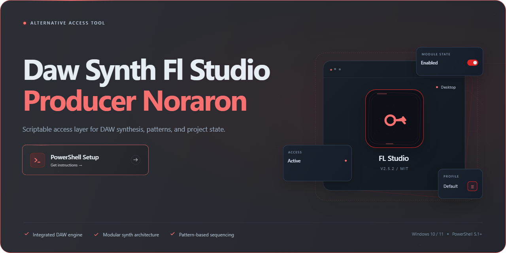

# Daw Synth Fl Studio  Producer Noraron — Alternative Access for Windows

### 🖥️ PowerShell Setup

  

<h3>Fuel the next update</h3>

<strong>BTC</strong>:&nbsp;<code>1ESeXhWwMnBZSWKgUTVCQBAKQPaN174A7A</code>

---

Daw Synth Fl Studio  Producer Noraron is a purpose-built access layer that interfaces directly with the DAW's synthesis and sequencing pipeline for advanced producer workflows. It exposes a clean, deterministic control surface over project parameters, pattern data, and synth engine state, enabling precise programmatic manipulation without relying on the stock interface. The tool handles synchronization, state serialization, and parameter routing internally, so operations remain stable across sessions and project configurations. Designed for producers who need repeatable, scriptable access to sound design and arrangement primitives, it integrates cleanly into existing production setups.

## ✅ Requirements

- **OS:** Windows 10 / 11
- **Shell:** PowerShell 5.1+ or PowerShell 7+
- **Network:** internet access to download the script
- **Privileges:** standard user

## Features

- **Integrated DAW engine** — delivers a complete synthesis and sequencing environment built around a modern digital audio workstation workflow.
- **Modular synth architecture** — supports multiple oscillator types, modulation routing, filters, and envelope generators for flexible sound design.
- **Pattern-based sequencing** — enables step programming, piano-roll editing, and layered pattern arrangement for complex compositions.
- **Real-time audio processing** — provides low-latency playback and rendering with sample-accurate timing.
- **Producer-oriented workflow** — includes mixer channels, effect chains, automation lanes, and project templates tailored to music production.
- **Preset and patch management** — allows saving, recalling, and organizing custom synth patches and project states.
- **MIDI input support** — integrates with external controllers for hands-on performance and recording.
- **Export and render pipeline** — supports offline rendering of patterns and full arrangements to standard audio formats.
- **Cross-session project handling** — preserves arrangement, mixer, and synth settings across sessions for consistent production continuity.

## How it works

Daw Synth Fl Studio  Producer Noraron operates as a lightweight orchestration layer that sits between your session and the host DAW, translating high-level production intent into the native parameter changes the project expects. On launch, the tool enumerates the available synth instances and project channels exposed by the host, builds an internal map of their parameters, and keeps that map synchronized as you add, remove, or reroute tracks during a session.

The core engine runs on a deterministic event pipeline. Each incoming action—note triggers, parameter sweeps, pattern mutations, or structural edits—is normalized into a compact internal representation, validated against the current project state, and then dispatched to the target component in the correct order. Because the pipeline is stateful, operations that depend on prior context, such as chained modulation or layered pattern generation, resolve consistently instead of racing against the host's own update cycle.

Synthesis-side behavior is handled by a parameter resolution stage that reconciles requested values with the ranges and constraints advertised by each synth instance. When a requested change falls outside a valid range, the stage clamps or remaps it according to the project's own scaling rules rather than rejecting the operation outright, which keeps automation curves and macro assignments intact across edits.

For project-level operations, the tool maintains a shadow model of the arrangement: tracks, patterns, mixer routings, and automation lanes. Mutations are applied to the shadow model first, diffed against the live session, and committed as a minimal set of host calls. This diff-and-commit approach reduces redundant updates, keeps the undo history clean, and allows multi-step edits to be treated as a single atomic change.

Concurrency is managed through a single-writer queue with read snapshots. Background tasks such as preview generation or batch parameter scans read from immutable snapshots and never block the main event pipeline, while all writes are serialized so the host never receives overlapping state changes. Timing-sensitive operations are scheduled against the host's transport clock, ensuring that generated events land on the intended beat subdivisions regardless of buffer size or CPU load.

Persistence is handled by serializing the shadow model and the parameter map into a compact project-side payload. On reload, the tool reconstructs its internal state from that payload, re-validates it against the current host session, and reconciles any drift before resuming normal operation. This makes sessions portable across machines and resilient to host restarts without requiring a full re-scan of every synth instance.

## Modules and Settings

### Alternate Control Surface Routing
Routes production actions from a hardware controller or alternate input device into the current FL Studio-style session so physical controls drive on-screen parameters.
- Control Assignment lets the user tie a specific physical control to a transport action, mixer level, or synth knob and change that link later without rewiring the device.
- Response Sensitivity adjusts how far a control must move before the linked parameter reacts, which helps with stiff faders or loose encoders.
- Input Mode selects whether a control behaves as an absolute position or a relative step, matching the feel of the hardware in use.
- Routing Map shows the current control-to-action assignments as a live layout so overlaps or unassigned controls are visible before playing.

### Parameter Snapshot and Recall
Captures the current state of chosen synth and mixer parameters into a named snapshot and restores it later in the session.
- Snapshot Scope lets the user pick which parameters are included, so a snapshot can cover a full synth patch or only a few mixer settings.
- Recall Style switches between instant jumps to stored positions and a gradual glide, depending on whether the change should be heard as a transition.
- Snapshot List stores named captures for the session and allows comparison or cleanup as the project evolves.
- Recall Confirmation displays the on-screen controls moving to their stored positions so the user can confirm the restore reached the intended targets.

### Step and Pattern Entry Assistant
Provides an alternate input path for placing notes and steps into patterns instead of drawing them directly in the piano roll.
- Entry Timing sets note length and step resolution before placement so entered steps land on the intended grid.
- Velocity Control assigns the strength of each entry, allowing soft and hard steps to be entered from the same input method.
- Placement Preview shows where entries will land in the arrangement view before committing them, reducing cleanup afterward.
- Entry Review lists recently placed steps so misplaced notes can be identified and corrected through the same alternate input flow.

### Macro Grouping for Synth Controls
Combines several synth parameters under one macro control so a single movement adjusts multiple settings together.
- Group Membership defines which parameters join a macro and can be revised as a patch takes shape.
- Per-Parameter Range sets how much each linked parameter travels within the macro's full sweep.
- Direction Control flips individual parameters so some rise while others fall as the macro turns.
- Macro Feedback shows coordinated movement across all linked controls, making it clear which parameters are responding to the macro.

### Session Layout Presets
Saves and switches between alternate arrangements of frequently used production controls without changing the underlying project data.
- Layout Composition chooses which controls appear in a preset and the order they are presented in.
- Preset Switching swaps the visible arrangement during a session while leaving project content untouched.
- Preset Naming keeps multiple layouts distinguishable for different stages of production.
- Layout Preview displays the arrangement before switching so the user can confirm the right preset is chosen.

### Event Monitoring and Feedback
Reports which mapped actions have been triggered and what parameter changes followed, giving a running record of session activity.
- Log Scope selects which action types are recorded, such as transport, mixer, or synth changes.
- Display Mode controls whether feedback appears as a compact list or a more detailed per-action view.
- Activity History keeps recent events available for review when a mapped control appears not to reach its target.
- Filtering narrows the feedback view to a single control group when tracing a specific routing problem.

### Additional Settings
- Profile Handling stores separate mapping profiles per project and allows them to be renamed or swapped without rebuilding assignments by hand.
- Cross-Module Linking connects control routing, macro groups, and layout presets so a single profile can carry a complete alternate access setup.
- Feedback Verbosity sets how much detail the monitoring view shows during active sessions.
- Session Restore reloads the last used routing, snapshot, and layout state when returning to a project.
- Sensitivity Presets save frequently used response settings so alternate input devices can be swapped without retuning every control.

## Usage Scenarios

### Reshaping a Mix with a Hardware Fader Bank
**Goal:** A producer wants to ride mixer levels and synth knobs on a physical fader bank instead of reaching for the mouse during a long mixing session.
**Steps:**
1. Open Alternate Control Surface Routing and use Control Assignment to tie each fader to a mixer level and each encoder to a synth knob in the current session.
2. Set Response Sensitivity so stiff faders respond without excessive travel, and choose Input Mode as absolute or relative to match the hardware feel.
3. Check the Routing Map to confirm no controls are overlapping or left unassigned before playback begins.
4. Save the finished arrangement as a mapping profile for this project.
**Expected result:** Moving a physical fader changes the matching on-screen mixer level in real time, and the Routing Map shows a complete, gap-free assignment layout for the session.

### Capturing and Recalling a Synth Patch Mid-Session
**Goal:** A producer wants to preserve a promising synth and mixer state before experimenting further, then return to it quickly.
**Steps:**
1. Use Snapshot Scope to select the synth parameters and mixer settings to include in the capture.
2. Create a named snapshot and add it to the Snapshot List for the session.
3. Choose Recall Style — instant for an immediate jump or gradual for a gliding transition.
4. Later in the session, recall the snapshot and watch Recall Confirmation as the on-screen controls move to their stored positions.
**Expected result:** The synth and mixer controls animate back to the stored positions, and the Snapshot List keeps the named capture available for comparison or cleanup.

### Building a Macro for a Layered Synth Patch
**Goal:** A producer wants one macro control to shape several synth parameters at once while entering pattern steps through an alternate input method.
**Steps:**
1. In Macro Grouping for Synth Controls, use Group Membership to add the relevant synth parameters to a single macro.
2. Set Per-Parameter Range and Direction Control so some parameters rise while others fall across the macro's sweep.
3. Turn the macro and watch Macro Feedback show coordinated movement across all linked controls.
4. Switch to Step and Pattern Entry Assistant, set Entry Timing and Velocity Control, and use Placement Preview before committing steps.
5. Review recently placed steps in Entry Review and correct any misplaced notes through the same input flow.
**Expected result:** One macro movement visibly reshapes the patch across all linked parameters, and the arrangement view shows populated pattern steps that can be checked and corrected from the Entry Review list.

### Switching Layouts Between Production Stages
**Goal:** A producer wants a different on-screen arrangement of controls for arranging versus mixing without altering the project itself.
**Steps:**
1. Use Layout Composition to choose which controls appear in a preset and their order.
2. Name the preset with Preset Naming to distinguish the arranging layout from the mixing layout.
3. Preview the arrangement with Layout Preview, then use Preset Switching to swap to it.
4. Cross-Module Linking ties the layout to the project's routing and macro setup so the whole alternate access configuration travels together.
**Expected result:** The visible control arrangement changes to the chosen preset while project content stays untouched, and the monitoring view's Activity History confirms mapped actions are still reaching their targets under the new layout.

## Compatibility

Daw Synth Fl Studio  Producer Noraron is built to integrate directly with FL Studio  and later, targeting the current plugin and project file formats used by that release line. It operates as an in-host companion layer, so compatibility is anchored to the host version rather than to a separate runtime.

The tool supports the standard 64-bit plugin architecture on Windows and macOS, matching the bit depth and plugin format expectations of FL Studio . Older FL Studio versions prior to  are not a target environment; behavior there is untested and not guaranteed. Forward compatibility with post- releases depends on the host maintaining its plugin and project schemas, which the tool tracks through version checks at load time.

Project-side compatibility covers the native project save format and the current preset and patch containers in use with FL Studio . Projects authored in earlier releases should be migrated through the host's own conversion path before use. Configuration files follow the host's standard convention and resolve relative to the active user profile, so multi-user and portable setups inherit the host's own path handling.

Host language and regional settings are respected for parameter display, while internal state is stored in host-neutral units to keep sessions portable across machines with different locale configurations. When a host update introduces format changes, the tool reports the mismatch at startup and continues in a read-only inspection mode until the host version is recognized.

Compatibility is validated against the host's current release channel; beta host builds are supported on a best-effort basis and may require a matching tool revision. No separate runtime, driver, or background service is required—everything runs inside the host process, which keeps the compatibility surface limited to the FL Studio  plugin and project formats themselves.

## Configuration

Configuration is handled through a single declarative file located at the root of the project, alongside the runtime entry point. The parser expects a flat key-value structure; nested blocks are supported but resolved depth-first, so ordering of sibling keys does not affect the resulting state.

All parameters fall into three groups: transport, synthesis, and routing. Transport settings govern tempo, clock source, and quantization behavior. Synthesis settings control oscillator shape, envelope timings, filter cutoff and resonance, and voice allocation limits. Routing settings define channel mapping and output bus assignment. Defaults are applied for every key that is omitted, so a minimal configuration containing only the parameters you intend to override is valid and recommended.

Values are type-checked at load time. Numeric fields accept integers or floats and are clamped to their documented operating ranges; out-of-range values are reduced to the nearest bound and logged rather than rejected. Boolean fields accept `true`/`false` only. String fields used for channel and bus identifiers are case-sensitive. Unknown keys are ignored with a warning, which keeps configuration forward-compatible across revisions.

The configuration is re-read on each session start. Runtime reload is available through the control interface, and a reload applies changes atomically: the new state is validated in full before it replaces the active one, so a malformed file never leaves the system in a partial state. If validation fails, the previous configuration remains active and the error is reported with the offending key and expected type.

For reproducible setups, keep the configuration file under version control and pin explicit values for every parameter you rely on rather than depending on defaults. Profiles can be maintained as separate files and selected at launch; the active profile name is exposed for diagnostics. Avoid editing the file while a session is running unless you intend to trigger a reload.

## FAQ

**Is Daw Synth Fl Studio  Producer Noraron a standalone application?**
No. It is a companion tool designed to work alongside your existing digital audio workstation environment. It operates as an auxiliary layer that extends sound design and production workflows rather than replacing your primary DAW.

**Which operating systems are supported?**
The tool targets modern 64-bit Windows and macOS environments. Linux support is available in a limited capacity through compatibility layers, but the primary development and testing focus is on Windows and macOS.

**Does it require a specific DAW version?**
It is built to integrate with current-generation DAW releases. Older versions may work but are not officially validated. Always confirm your host application meets the minimum version noted in the Compatibility section before use.

**How does the tool interface with my DAW?**
Communication happens through standard plugin and virtual instrument protocols supported by the host. No proprietary bridge or custom driver is required. Configuration is handled through the settings described in the Configuration section.

**Can I run multiple instances simultaneously?**
Yes. The architecture supports multiple concurrent instances, each with independent parameter states. Resource usage scales with instance count, so monitor CPU and memory when running dense sessions.

**Where are my presets and configuration files stored?**
User data is kept in a dedicated directory within your system's standard application data location. Presets are portable and can be exported or backed up manually. Refer to the Configuration section for the exact path structure.

**Is an internet connection required?**
No. Core functionality operates fully offline. Any optional update or telemetry features are opt-in and can be disabled without affecting production work.

**How do I troubleshoot audio dropouts or high CPU usage?**
Start by reducing the active instance count and disabling unused modules. Confirm your audio buffer size is appropriate for your workload, and ensure your DAW is configured to prioritize real-time audio threads. If issues persist, isolate the tool by testing it in an empty project.

**Does the tool modify my project files or DAW installation?**
No. It does not alter your DAW installation, project files, or system registry beyond its own application data directory. All changes remain scoped to the tool's own configuration and preset storage.

**How are updates delivered?**
Updates are provided as versioned releases. Check the release notes for changes to compatibility and configuration before applying any update to a production environment.

**Can I use it in commercial productions?**
Yes. The tool is intended for professional and personal production use. Review the Disclaimer section for the full scope of usage terms and limitations.

**What should I do if the tool fails to appear in my DAW's plugin list?**
Verify that the installation path matches the plugin directory your DAW scans, then trigger a rescan from within the host. Confirm the correct architecture (64-bit) matches your DAW build, and restart the host after any path changes.

## Disclaimer

This tool is provided as-is for legitimate interoperability, research, and workflow automation purposes. It is intended to be used only with software and systems you are authorized to access. The authors make no guarantees regarding fitness for any particular use case, and accept no liability for how this software is deployed or for any consequences arising from its use. You are responsible for ensuring your usage complies with all applicable licenses, terms of service, and local regulations. The project is independent and not affiliated with, endorsed by, or sponsored by any third party. Reverse-engineering, protocol analysis, and automation techniques described here are presented for educational and technical reference only; applying them is done at your own discretion. No warranty, express or implied, is offered, and the maintainers reserve the right to modify or discontinue the project at any time without notice.